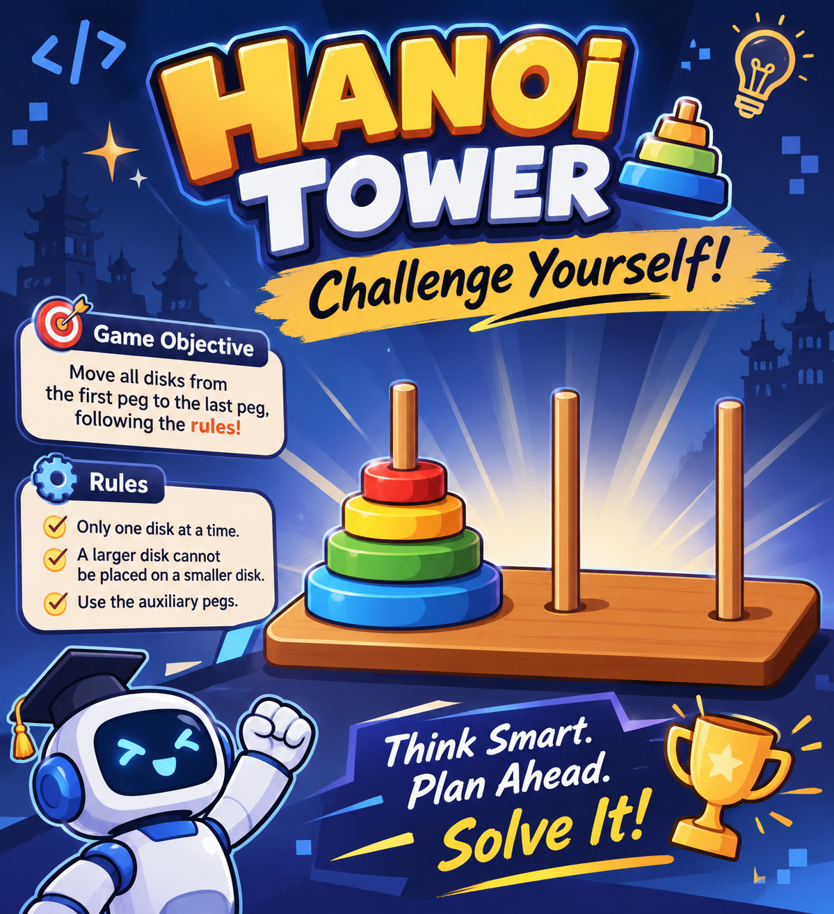
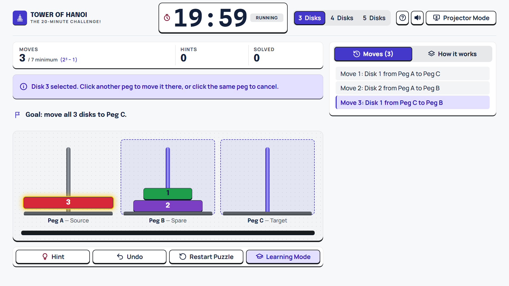
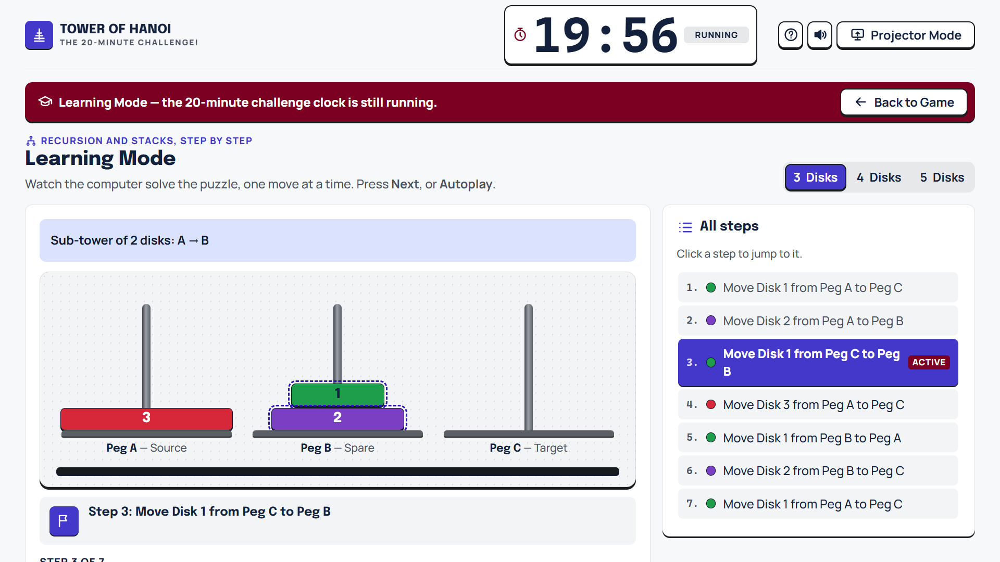
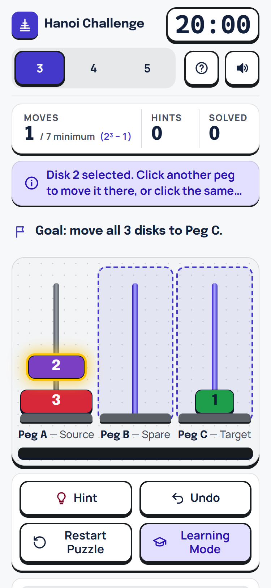
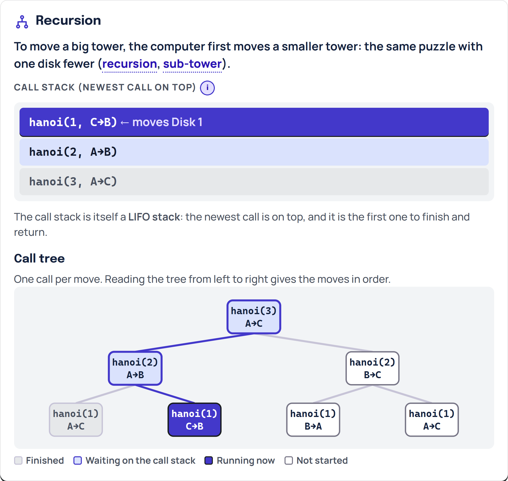
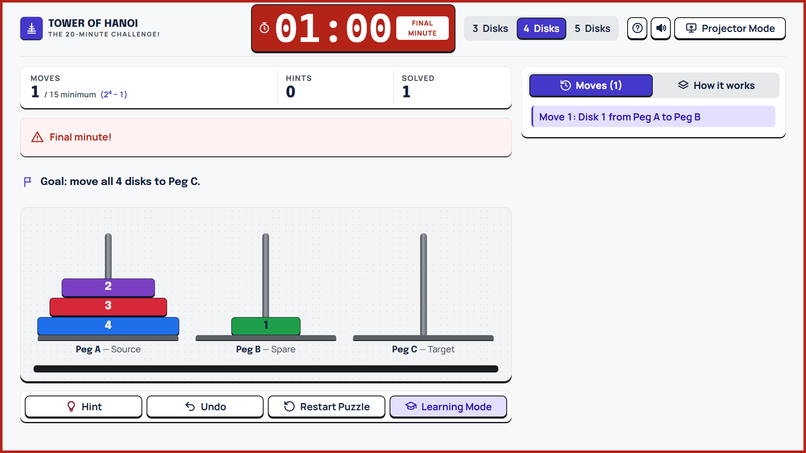
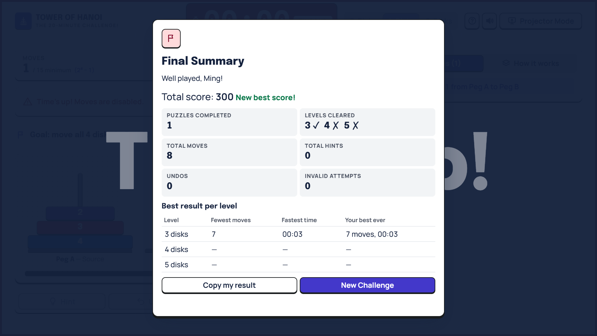
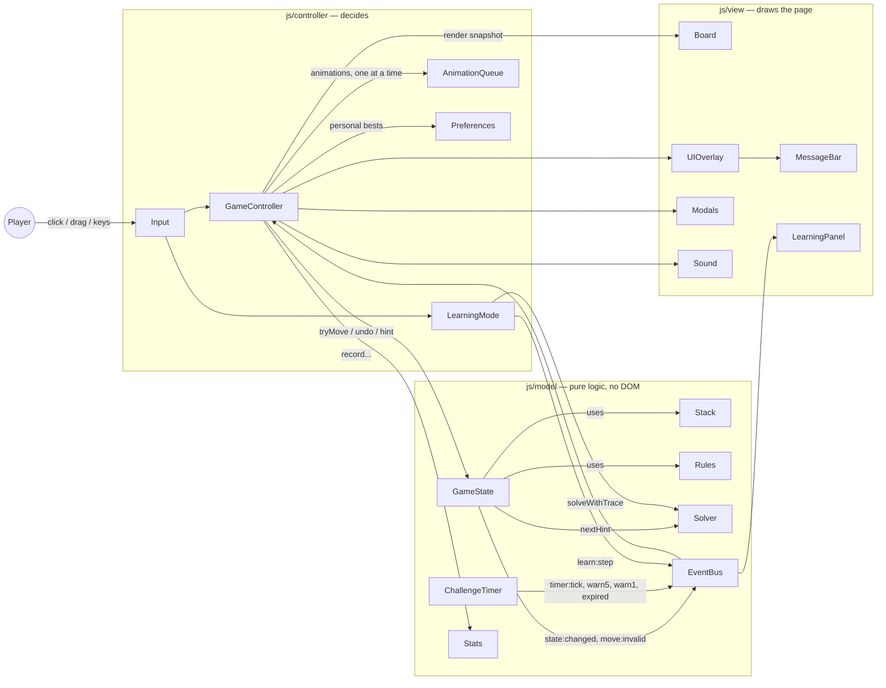

<p align="center">
  <picture>
    <source srcset="assets/poster.webp" type="image/webp">
    
  </picture>
</p>

# Tower of Hanoi: The 20-Minute Challenge!

A browser game and teaching tool for a Data Structures & Algorithms course.
Solve the Tower of Hanoi with 3, 4 or 5 disks against a 20-minute clock, and use
Learning Mode to see how **stacks (LIFO)** and **recursion** solve the puzzle in
the minimum **2ⁿ − 1** moves.

**Live site:** <https://roycenchew.github.io/Tower-of-Hanoi-The-20-Minute-Challenge-/>

Vanilla HTML, CSS and JavaScript (ES modules). No frameworks, no dependencies, no build step.
Fonts (Epilogue and Manrope) and icons are stored in the project, so the game also works offline.

---

## Features

**The game**
- Three pegs labelled *Peg A — Source*, *Peg B — Spare*, *Peg C — Target*; 3, 4 or 5 disks.
  Disk colours: 1 green, 2 purple, 3 red, 4 blue, 5 orange; every disk also shows its number.
- Every peg is a real **Stack** (`push`, `pop`, `peek`, `isEmpty`, `size`) with a private array.
- Illegal moves are blocked with a clear message, a shake and a red "Invalid" log entry,
  and never change the move counter.
- Click-to-select, drag-and-drop (mouse and touch) and keyboard shortcuts.
- Move counter, minimum moves (2ⁿ − 1), move history log, and a live "How it works" panel
  showing each move as `pop()` and `push()`.
- **Hint** (best next move from *any* position), **Undo**, **Restart Puzzle**.
- Victory screen comparing your moves with the minimum, with stars and efficiency.

**The 20-minute challenge**
- One continuous countdown from 20:00. It has **no pause method**: hints, Learning Mode,
  restarts and difficulty changes never stop it.
- Warnings at 5:00 and 1:00 (colour, banner, sound, red border), with no layout shift.
- At 00:00: input locks, animations and autoplay stop, a full-screen "Time's up!" appears,
  then the Final Summary (puzzles completed, levels cleared, total moves, total hints, and more).
- Early finishers move up: "Next Level: 4 Disks", then 5.

**Learning Mode**
- Step-by-step replay of the optimal solution on its own board (your game is untouched):
  Previous, Next, Autoplay, Pause, speed 0.5× / 1× / 2×, Reset, or click any step to jump to it.
- For each step: the stack operations, the three stacks, the **call stack** and the
  **recursion call tree**, plus the sub-tower being moved.
- Theory cards: why the minimum is 2ⁿ − 1, why every peg is a stack, and sub-towers.

**Friendly for beginners**
- A 5-step **guided tour** on the first visit (the **?** button opens it again at any time),
  ending with an optional **practice puzzle** that is not timed and not counted.
- A clear goal line above the board, a calm screen (the move log and "How it works" are tabs),
  and friendly nudges: encouragement after the first move, and "Stuck? Try the Hint button."
  after 3 mistakes in a row or 20 seconds without a move.
- Plain words first: "How it works" starts with a sentence; computer-science words
  (*stack*, *LIFO*, *pop/push*, *2ⁿ − 1*, *recursion*, *call stack*, *sub-tower*) explain themselves when tapped.
- Learning Mode starts simple; "Show how the computer thinks" and "Why does this work?" open the detail.

**Classroom and phone friendly**
- Responsive from 360 px phones to 4K projectors; **Projector Mode** (+25% text, thicker lines).
- Accessible: real buttons, screen-reader labels and live regions, visible focus, full
  keyboard play, text contrast at least 4.5:1, reduced-motion support.
- Sound effects made with the Web Audio API (mute button); personal bests saved in the browser.

## How to play

1. Click **Start Challenge** (a nickname is optional).
2. Move all disks from **Peg A** to **Peg C**: click a peg to pick up its top disk, then click
   another peg to put it down (or drag the disk).
3. Only the top disk can move, and a bigger disk can never go on a smaller one.
4. Solve as many puzzles as you can before the clock reaches 00:00.

### Keyboard shortcuts

| Key | Action |
|---|---|
| A / B / C or 1 / 2 / 3 | Select a peg, or drop the lifted disk on it |
| Esc | Put the lifted disk back down |
| Ctrl+Z or U | Undo |
| H | Hint |
| R, then R again within 2 s | Restart Puzzle |
| **Learning Mode:** Space | Autoplay / Pause |
| **Learning Mode:** ← / → | Previous / Next step |

Shortcuts are ignored while typing in the nickname box or while a dialog is open.

## Screenshots

| Game (desktop) | Learning Mode | Phone |
|---|---|---|
|  |  |  |

| Recursion call tree (n = 3, step 3) | Final minute | Final Summary |
|---|---|---|
|  |  |  |

More in [`docs/screenshots/`](docs/screenshots/).

## Architecture

The code is split into three layers. The **model** is pure logic and never touches the
page, so it runs in Node unit tests. It announces changes on an **EventBus**; the
**controller** reacts and asks the **views** to redraw. Principle: *the state changes
first, the picture catches up* (animations only show what already happened).



## Where each requirement lives

| Requirement | Code |
|---|---|
| Pegs as LIFO stacks (`push`, `pop`, `peek`, `isEmpty`) | `js/model/Stack.js` |
| Move validation and error messages | `js/model/Rules.js` |
| Move counter, undo history (also a stack), move log | `js/model/GameState.js` |
| Recursive solver, call trace, hint from any position | `js/model/Solver.js` |
| 20-minute timer, warnings, no pause | `js/model/ChallengeTimer.js` |
| Totals, stars, score, personal bests (pure) | `js/model/Stats.js` |
| Screen states, input gate, Time's up sequence | `js/controller/GameController.js` |
| Step-by-step Learning Mode | `js/controller/LearningMode.js`, `js/view/LearningPanel.js` |
| Click, drag-and-drop, keyboard | `js/controller/Input.js` |
| Animations without losing sync | `js/controller/AnimationQueue.js`, `js/view/Board.js` |

## How to run locally

The game uses ES modules, which browsers do not load from `file://`.
Start a small local server in the project folder, then open the page:

```bash
python -m http.server 8765
```

Open <http://localhost:8765> in your browser.
(The VS Code **Live Server** extension also works.)

On Windows, if you see `PermissionError: [WinError 10013]`, the port is reserved by Windows
(check with `netsh interface ipv4 show excludedportrange protocol=tcp`). Pick another port, e.g. `python -m http.server 5500`.

Add `?debug=1` to the URL (<http://localhost:8765/?debug=1>) to show the timer debug panel
("Jump to 5:05 / 1:05 / 0:05"). Without it, the debug code is not even downloaded.

## How to run the tests

Needs Node.js 22 or newer. There are no npm packages to install.

```bash
npm test
# or
node --test "tests/*.test.js"
```

**158 unit tests** across 14 files. Test cases from the report's test table appear in the
test names:

| ID | What is tested | File |
|---|---|---|
| TC-01 | Empty source peg: "Source peg contains no disks.", counter unchanged | `gamestate`, `controller` |
| TC-02 | Disk 3 onto Disk 1 (click and drag): blocked, counter unchanged, red log entry | `gamestate`, `controller`, `challenge` |
| TC-03 | Time's up: input disabled at once, autoplay halts, summary after 1.5 s | `challenge` |
| TC-04 | Undo after 5 moves: board as after move 4, counter = 4 | `gamestate` |
| TC-05 | Learning Mode autoplay while the 20-minute clock keeps running | `challenge`, `learning` |
| TC-14 / 16 / 18 | Hint, difficulty change and Restart never stop the timer | `challenge` |
| TC-22 / 23 | Time runs out during a drag / during a move animation | `challenge` |
| TC-25 | Rapid clicks during an animation | `challenge` |

The interface was also checked in headless Chrome at 360, 375, 768, 1024, 1280, 1366, 1920
and 3840 px (no horizontal scroll, no layout shift during warnings, welcome card never
covering the disks, accessibility names, focus rings, colour contrast).

## File structure

```
index.html                    the page (with Open Graph / Twitter preview tags)
assets/                       poster (PNG + WebP), welcome banner crop, link-preview image
assets/fonts/                 Epilogue + Manrope (woff2) with their OFL licences
css/base.css                  fonts, colour variables (with contrast ratios), size variables, reset, icons
css/layout.css                regions, breakpoints, timer warnings, 4K, Projector Mode
css/board.css                 pegs, disks, selection, hint pulse, drag, shake
css/components.css            buttons, message bar, panels, welcome, modals, Learning Mode
js/main.js                    entry point: creates objects and wires events

js/model/                     pure logic, no DOM (runs in Node tests)
  Stack.js                    the LIFO stack behind every peg
  Rules.js                    validateMove() and all player messages
  GameState.js                pegs, move counter, undo history, move log, hints
  Solver.js                   recursive solve(), solveWithTrace(), nextHint()
  ChallengeTimer.js           the 20-minute countdown (no pause method)
  Stats.js                    totals, stars, score, share text, personal bests
  EventBus.js                 on / off / emit

js/controller/
  GameController.js           screen states, input gate, challenge flow, Time's up sequence
  Input.js                    clicks, drag-and-drop (Pointer Events), keyboard, top-bar tools
  AnimationQueue.js           runs move animations one at a time (busy / clear)
  LearningMode.js             step-by-step walkthrough on its own board
  Preferences.js              localStorage (sound, Projector Mode, nickname, bests), try/catch

js/view/
  Board.js                    draws pegs and disks; move, drag and return animations
  UIOverlay.js                timer, metrics, move log, "How it works", top-bar tools
  MessageBar.js               message priority: timer warnings always get 4 s
  Modals.js                   welcome card, victory, Time's up, final summary
  LearningPanel.js            demo board, steps, Stack panel, call stack, call tree
  Confetti.js                 confetti when a puzzle is solved
  Sound.js                    Web Audio sound effects
  Tour.js                     the guided tour (spotlight + steps)
  Glossary.js                 tap-to-explain computer-science words
  DebugPanel.js               timer jumps, loaded only with ?debug=1

tests/                        unit tests (npm test)
docs/screenshots/             screenshots for the report
docs/                         assignment brief and design reference (kept local, not in git)
```

## Accessibility

- Every control is a real `<button>`; pegs are announced as e.g. "Peg A, Source, 3 disks, top disk 1".
- Messages use `aria-live="polite"`; timer warnings and "Time's up!" are announced at once (`assertive`).
- A full game can be played with the keyboard only, with a visible focus ring on every control.
- Text contrast is at least 4.5:1 (ratios for every disk colour are listed in `css/base.css`).
- `prefers-reduced-motion`: no animations or confetti; moves still happen instantly.

## Credits

- Visual design based on the author's own mock-up (`docs/design/`, kept local).
- Fonts: [Epilogue](https://github.com/Etcetera-Type-Co/Epilogue) and
  [Manrope](https://github.com/googlefonts/manrope), SIL Open Font License 1.1
  (licence files in `assets/fonts/`).
- Poster: made by the author.

## Author

_Your name and student ID here._
